# Docker Fundamentals: კონტეინერები, იმიჯები და მუდმივი მონაცემები

ამ პროექტში ნაბიჯ-ნაბიჯ არის აღწერილი Docker-ის საფუძვლები: კონტეინერების გაშვება, საკუთარი Python იმიჯის აწყობა და Docker Volume-ებით მონაცემების შენახვა.

## პროექტის სტრუქტურა

```
Docker-Fundamentals/
├── python-app/
│   ├── app.py          # მარტივი Python სკრიპტი
│   └── Dockerfile      # იმიჯის აღწერა
├── screenshots/        # სქრინშოტები
└── README.md
```

---

## ნაწილი 1: კონტეინერების გაშვება და შესწავლა

### 1.1 Hello World კონტეინერი
```powershell
docker pull hello-world
docker run hello-world
```
`docker pull` იმიჯს Docker Hub-იდან ჩამოტვირთავს, `docker run` კი მისგან კონტეინერს უშვებს. შედეგში გამოდის "Hello from Docker!", რაც ადასტურებს, რომ Docker სწორად მუშაობს.

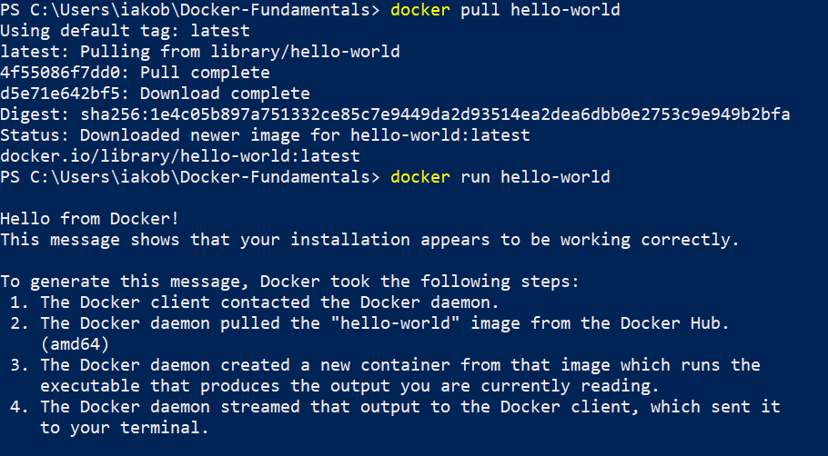

### 1.2 ინტერაქტიული Ubuntu კონტეინერი
```powershell
docker run -it --name my-ubuntu ubuntu bash
```
`-it` ინტერაქტიულ ტერმინალს ხსნის, `--name` კონტეინერს სახელს არქმევს. prompt `root@<id>:/#`-ზე შეიცვალა, ანუ ახლა კონტეინერის შიგნით ვართ.

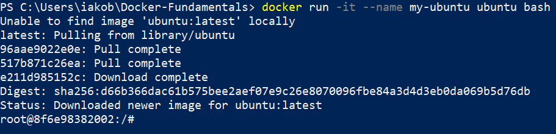

### 1.3 curl-ის ინსტალაცია და ინტერნეტის შემოწმება
```bash
apt update
apt install curl -y
curl https://google.com
```
`apt update` პაკეტების სიას ანახლებს, `apt install curl -y` აინსტალირებს curl-ს, `curl https://google.com` კი ამოწმებს ინტერნეტთან წვდომას (პასუხად google-ის გადამისამართების გვერდი ბრუნდება).

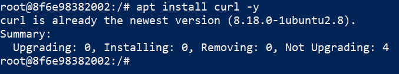

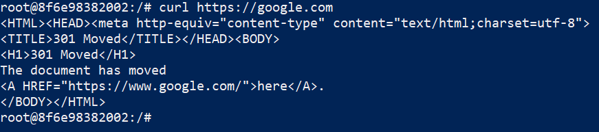

### 1.4 კონტეინერიდან გამოსვლა
```bash
exit
```
ტერმინალი ისევ ჩვენს კომპიუტერზე დაბრუნდა, კონტეინერი კი გაჩერდა.

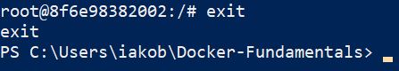

### 1.5 კონტეინერების სია, გაჩერება და წაშლა
```powershell
docker ps -a
```
`docker ps` მხოლოდ მოქმედ კონტეინერებს აჩვენებს, `docker ps -a` ყველას (გასულებსაც).

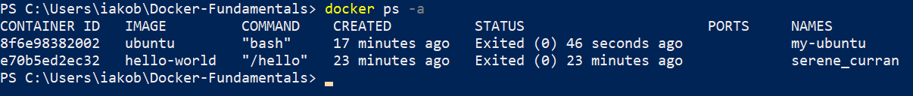

```powershell
docker stop my-ubuntu
docker rm my-ubuntu
docker ps -a
```
კონტეინერი გავაჩერეთ და წავშალეთ, ამიტომ სიიდან გაქრა.

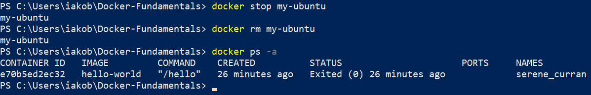

---

## ნაწილი 2: საკუთარი Python აპლიკაციის იმიჯი

### 2.1 სამუშაო საქაღალდე
```powershell
mkdir python-app
cd python-app
ls
```
შევქმენით ცალკე საქაღალდე პროექტის ფაილებისთვის.

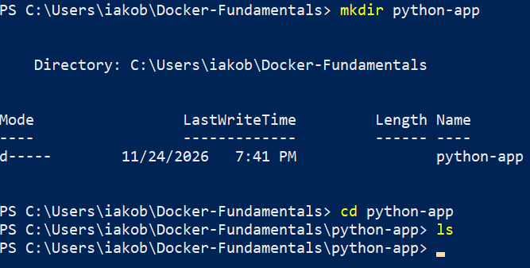

### 2.2 Python სკრიპტი
```powershell
cat app.py
```
მარტივი სკრიპტი, რომელიც ბეჭდავს მისალმებას, Python-ის ვერსიას და მიმდინარე დროს (ფაილი `python-app/app.py`).

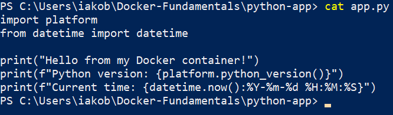

### 2.3 Dockerfile
```powershell
cat Dockerfile
```
`FROM` საბაზო იმიჯს განსაზღვრავს (`python:3.12-slim`), `WORKDIR` სამუშაო საქაღალდეს, `COPY` სკრიპტს გადააქვს იმიჯში, `CMD` კი კონტეინერის გაშვებისას ბრძანებას (ფაილი `python-app/Dockerfile`).

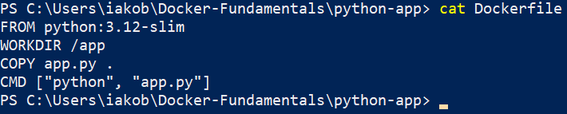

### 2.4 იმიჯის აწყობა (Build)
```powershell
docker build -t my-python-app .
```
Docker Dockerfile-ის მიხედვით ააწყობს იმიჯს სახელით `my-python-app`.

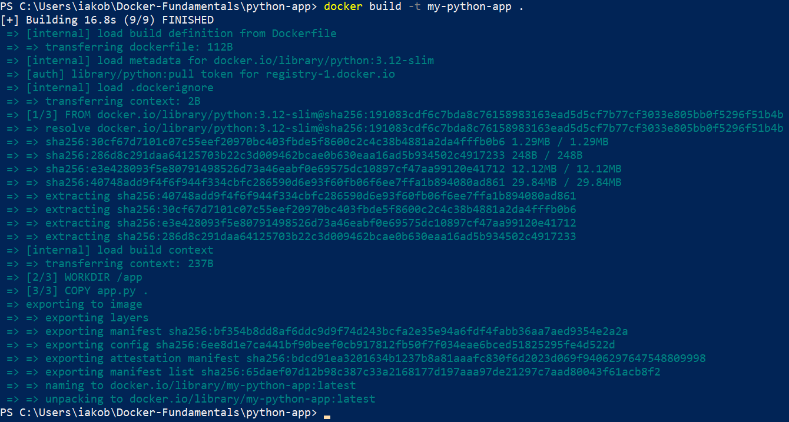

### 2.5 კონტეინერის გაშვება იმიჯიდან
```powershell
docker run my-python-app
```
კონტეინერი გაეშვა და სკრიპტმა დაბეჭდა შედეგი.

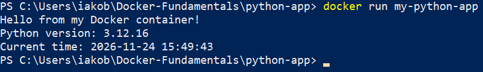

### 2.6 თეგი და იმიჯების სია
```powershell
docker tag my-python-app my-python-app:v1.0
docker images
```
იმიჯს დაემატა თეგი `v1.0`. სიაში ორი ჩანაწერია (`latest` და `v1.0`) ერთი და იგივე IMAGE ID-ით.

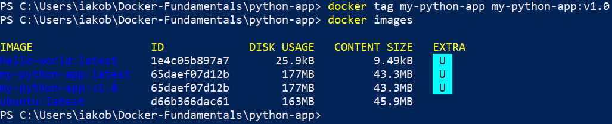

---

## ნაწილი 3: Docker Volume-ები

### 3.1 Named Volume-ის შექმნა
```powershell
docker volume create my-volume
docker volume ls
docker volume inspect my-volume
```
შევქმენით volume `my-volume`, დავრწმუნდით, რომ სიაშია და ვნახეთ მისი დეტალები.

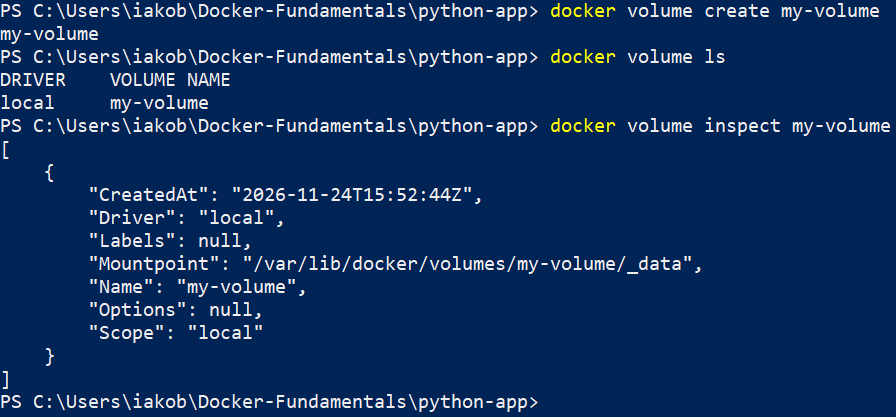

### 3.2 და 3.3 კონტეინერი volume-ით და ფაილის შექმნა
```powershell
docker run -it --name ubuntu1 -v my-volume:/data ubuntu bash
```
```bash
echo "Hello Docker Volume!" > /data/test.txt
cat /data/test.txt
ls -l /data
exit
```
`-v my-volume:/data` volume-ს კონტეინერის `/data` საქაღალდეზე მიაბამს. ფაილი ჩავწერეთ `/data`-ში, ამიტომ ის volume-ში ინახება.

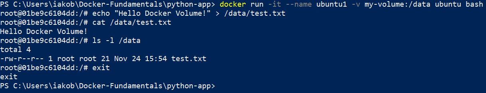

### 3.4 მონაცემების შენახვის დადასტურება
```powershell
docker rm ubuntu1
docker run -it --name ubuntu2 -v my-volume:/data ubuntu bash
```
```bash
cat /data/test.txt
exit
```
პირველი კონტეინერი წავშალეთ, მეორე კონტეინერი კი იმავე volume-ით გავუშვით და ფაილი ისევ იქ დაგვხვდა. ეს ადასტურებს, რომ volume-ში მონაცემები კონტეინერებისგან დამოუკიდებლად ინახება.

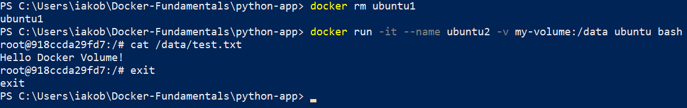

---

